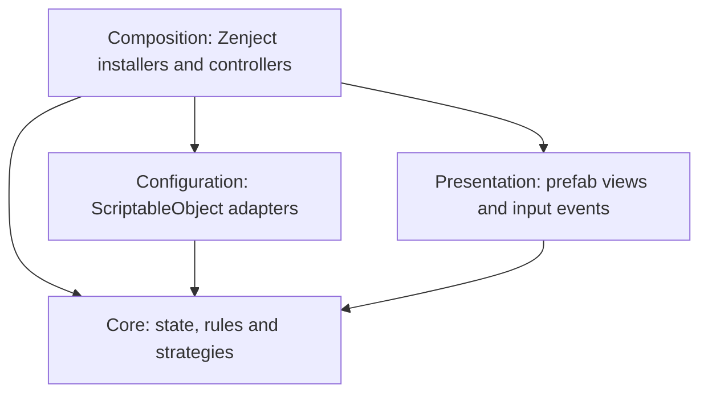

# Okey Rummy

A Unity portfolio project for tile-based Okey and Rummy games, with a warm coffeehouse table, configurable Classic Okey and 101 Okey rulesets and three local AI opponents.

Game rules and state live in a Unity-independent C# assembly. Zenject connects the application, while editable prefabs and ScriptableObjects control presentation and configuration. Classic Okey and 101 Okey share the same table, rack and input infrastructure, with separate gameplay policies, rule profiles, scoring and bot strategies.

## Run the project

1. Clone the repository and open it with **Unity 6000.3.15f1** through Unity Hub.
2. Let Unity restore the packages and import the assets.
3. Open **Assets/Scenes/MainMenu.unity** and press Play.
4. Choose Classic Okey or 101 Okey, individual or partnership play, and humanlike or fast opponents. 101 tables also support fixed or rising opening thresholds. Select **Play** to start a table.

The main menu is the first scene in Build Settings. **SampleScene.unity** can also be opened directly for table development. Zenject and DOTween are included in the repository; no separate plugin installation is needed.

## Features

- Classic Okey: closed 14-tile hands, seven-pair finishes, high-one runs and discard pickup before opening.
- One human player and three AI opponents, with individual and opposite-seat partnership modes.
- Runs, sets and pairs, indicator-based real jokers and physical fake jokers.
- Series and pair opening thresholds, configurable penalties, round scoring and rising openings (*katlamalı*).
- Two rack rows with adjacent placement, optional gaps and insertion that shifts neighboring tiles.
- Opening totals calculated from the player's actual adjacent rack groups.
- Drawing from the closed pile, corner discard trays, double-tap discarding and drag-and-drop layoffs.
- Public melds on separate series and pair boards, with reserved extension slots, compatible drop-target highlights and paging.
- Plain tile backs, manual tile flipping, distinct color settings and editable typography.
- Remaining seconds and progress bars for the active seat, with automatic legal play on timeout.
- A small new-game menu, contextual help and table settings.

## Controls

| Action | Input |
| --- | --- |
| Draw | Click the closed pile, or drag its top tile to the rack during your turn. |
| Arrange | Drag a tile to a rack slot. Occupied slots shift toward the nearest gap. |
| Separate groups | Leave an empty slot between groups. Groups do not cross rack rows. |
| Open series or pairs in 101 | Use the opening card showing the matching tile example and current total. |
| Finish Classic Okey | Discard the spare tile from a complete hand, or select **Finish** when enabled. |
| Lay off a tile | Drag it into the highlighted empty cell of a compatible public meld. |
| Discard | Drop a tile into the bottom-right tray, or double-tap it during your discard phase. |
| Flip a tile | Hold it for half a second. Hold again to turn it face up. |
| Take the previous discard | Classic: click the previous player's tray to take the tile into your rack. 101: once opened, click it to immediately extend a compatible public meld. |
| Start another game | Open table settings and select **New Game** to return to the menu. |

Rack rearrangement is available during other players' turns. Draws, openings, layoffs and discards always pass through the table's legality checks.

## Rules in this build

### Classic Okey

The starting seat receives **15 tiles**, the other seats receive **14**, and a standard deck leaves **48 tiles** in the stock after the indicator is set aside. Hands remain closed: there are no public openings, layoffs, 101 opening penalties or rising thresholds. A player may draw from the pile or take the previous seat's latest discard directly into their rack.

Discarding the spare tile wins when all fourteen remaining physical tiles can be assigned exactly once to runs and sets, or to seven identical pairs. The validator finds a complete disjoint partition, rather than judging the total value of a few high-scoring melds. The **Finish** action chooses a legal spare tile when a complete hand exists. Adjacent rack groups still drive the progress cards. A completed winning hand is exposed in the center of the table, including bot wins.

Classic runs allow **12–13–1**, but reject **13–1–2**. Real jokers substitute for missing tiles; fake jokers retain the real joker's fixed printed identity. Seven-pair completion takes priority if the same hand can also form runs. The bot protects tile coverage and considers useful previous-seat discards while keeping its hand closed.

The default score records round loss points: an ordinary winner receives zero and other players receive two. Pair and joker finishes use the profile's configurable multipliers; in this build they stack, giving four for either bonus and eight for both. Partnership tables exclude the winning partner and sum individual loss points by team. This uses the project's round-score convention; there is no cumulative twenty-point match or indicator-show bonus.

An empty stock leaves the previous discard available. Taking it continues the turn; choosing the empty pile instead ends a drawn round with zero score. Timers and the existing humanlike/fast bot modes work in both games.

The base hand, meld and pickup rules follow the [Okey rules reference](https://www.pagat.com/rummy/okey.html); score aggregation and combined bonus multipliers above are explicit project choices.

### 101 Okey

The default table uses a 106-tile deck. A random starting seat receives 22 tiles; the other seats receive 21. An indicator is set aside and 20 tiles remain in the stock. Subsequent tables rotate the starting seat. The indicator determines the real joker; fake jokers represent that fixed color and value.

An initial series opening needs **101 points**, or a pair opening needs **five pairs**. The local opening evaluator uses adjacent tiles on the same rack row and reserves a tile for the final discard. Invalid opening attempts apply a configurable penalty and preserve the hand. Additional melds use the player's existing opening mode. Joker assignments in public melds remain fixed. Each series or set occupies its own row. Runs use number-aligned columns: 1–2–3 starts at the left edge, while 3–4–5 reserves two positions on its left and the remaining values on its right. Sets reserve fixed color slots. Adding tiles keeps existing tiles and other melds in place. Rows fill downward through separate lanes; page buttons or the mouse wheel keep a full board accessible without shrinking tiles.

Rising openings increase the series and pair thresholds independently. Each successful initial opening sets its corresponding next threshold to the opened total plus a configurable increment, which defaults to one. Additional melds and invalid attempts do not raise thresholds.

101 forbids taking a discard while closed. An opened player may take only the previous seat's latest discard, and only to immediately extend a public meld. Failed pickups change neither the discard nor the stock.

Successful openings refresh the turn timer. When time expires, the game cancels any drag, draws if required and discards legally. Discarding the final tile finishes the round. Partnership scoring groups opposite seats and excludes the winning partner's remaining hand.

Layout preview using a custom stress-test deck: number-aligned runs, fixed color slots and twenty public melds across two pages.

These are the project's explicit rule choices. Other regional variants, indicator-show bonuses and cumulative multi-round matches are not implemented.

## Architecture

| Assembly | Responsibility |
| --- | --- |
| `Okey.Core` | Immutable tile definitions, physical identities, decks, rack arrangement, meld validation, table state, scoring and AI observations. It has no Unity engine references. |
| `Okey.Configuration` | Converts editable assets into rule, deck, table and navigation settings. |
| `Okey.Presentation` | Passive table views, tile faces, pointer input, rack anchors, progress bars, menus and animations. |
| `Okey.Composition` | Creates dependencies, coordinates views with the table and routes local, bot and timeout actions. |

`TableSession` owns hands, turn phase, public melds and discard histories. `ITableGame` supplies public-meld permissions, discard behavior, finish validation and scoring through `Okey101Game` or `ClassicOkeyGame`. The table has no game-name or mode-enum branches. Presentation does not decide move legality. `RackArrangement` manages physical tile placement independently of turn rules, and `RackMeldEvaluator` evaluates the local arrangement without Unity APIs.

`StoneInstance` gives each physical tile an ID; duplicate printed tiles remain separate objects. Deck generation, shuffling, distribution and view creation are separate responsibilities. `IStoneShuffler` supports replaceable ordering, and seeded implementations support deterministic tests.

### Extension points

| Change | Boundary |
| --- | --- |
| Deck composition, tile range or copy count | `DeckSettings` / `DeckDefinition` |
| A new game mode | Derive a `TableRuleProfile`, supply an `ITableGame` and `IPlayerStrategy`, then add the asset to `TableSettings` |
| Run, set, pair or joker validation | `IMeldRules` / `OkeyRules.AllowsHighOne` |
| End-of-round scoring | `IRoundScoring` |
| Opponent decisions | `IPlayerStrategy` |
| Behavioral randomness | `IRandomSource` |
| Menu and table navigation | `ITableNavigation` |
| Tile art, text, colors and animation | Prefabs and visual settings assets |

Fast opponents play at a fixed pace. Humanlike opponents use configurable thinking delays, opening patience and a default 1% mistake chance per discard decision. Their strategies receive snapshots of their own hand and public information; they cannot inspect opponents' hands or the stock. Bot decisions use current rising thresholds and the same table actions as local input.

Multiplayer is not implemented. A future transport adapter can submit actions to the table boundary and distribute public and seat-private state. It must add session identity, authoritative validation, synchronization and visibility handling. Supporting another Okey or Rummy variant also requires adapting the table flow where its turn or opening rules differ; changing configuration alone does not implement every variant.

## Configuration and presentation

| Asset | Editable values |
| --- | --- |
| `Assets/Settings/Dealing/Standard101Table.asset` | Available rule profiles, selected profile, player count, rising increment, partnerships, pickup rules, starter selection, timers and bot behavior. |
| `Assets/Settings/Dealing/Okey101Rules.asset` | 101 hand size, tile range, opening thresholds, penalties and score multipliers. |
| `Assets/Settings/Dealing/ClassicOkeyRules.asset` | Classic hand size, tile range, pair count, round loss points and score multipliers. |
| `Assets/Settings/Decks/StandardOkeyDeck.asset` | Tile types, colors, number ranges and copies. |
| `Assets/Settings/Dealing/StandardOpeningDeal.asset` | Fixed or random shuffle seed. Its practice-hand fields are separate from table settings. |
| `Assets/Settings/Dealing/SceneNavigation.asset` | Menu and table scene names. |
| `Assets/Settings/Stones/DefaultStoneVisualSettings.asset` | Printed tile colors and fake-joker text. |
| `Assets/Settings/Animations/DefaultStoneMotionSettings.asset` | Movement duration, easing and time scaling. |
| `Assets/Prefabs/NewGameMenu.prefab` | Menu layout, labels, buttons and transition. |
| `Assets/Prefabs/GameControls.prefab` | Draw surface, discard trays, opening cards, boards, opponent cards, timers, help and settings. |
| `Assets/Prefabs/Istaka.prefab` | Rack geometry, row capacity, slot anchors and tile scale. |
| `Assets/Prefabs/Stone.prefab` | Tile body, font, symbol, face visibility, selection and hold behavior. |

### Editing UI without changing code

Open **Assets/Prefabs/GameControls.prefab** in Prefab Mode. Its root **TableView** contains references to the small views that own each part of the screen. The custom inspector includes an **Edit dynamic wording** button and a list of all text elements, including hidden panels. Selecting an element opens its own TextMeshPro and RectTransform settings.

| Change | Edit here |
| --- | --- |
| Font asset, font size, alignment, wrapping, spacing or text color | The selected text object's TextMeshPro component inside the prefab |
| Position, anchors, pivot, width or height | That object's RectTransform; moving the parent moves the whole card/panel |
| Status messages, action labels, progress formats, seat names and menu options | **Assets/Settings/Presentation/EnglishTableText.asset**, referenced by both table and menu prefabs |
| Fixed headings and instructions | Their own text objects inside the prefab; **ClassicTitle** and **ClassicDescription** have independent font sizes |
| Opening-card behavior and progress fill | **MeldActionView** on each series/pair card |
| Clock bars and clock text references | **TurnClockView** on the turn clock |
| Modal buttons and help text reference | **OverlayPanelsView** on the canvas |
| Table settings buttons and labels | **TableOptionsView** on the canvas |
| Opponent text/highlight | **OpponentSeatView** on the corresponding opponent |
| Draw, discard, board and winning-hand geometry | **TableSurfaceView** on the root; board cells use each **MeldBoardView** |

Save changes in Prefab Mode outside Play Mode. Scene-instance overrides take precedence over prefab values; changes made to runtime instances during Play Mode disappear when Play Mode ends. Dynamic text content is formatted from the assigned catalog, so editing a live label's text is temporary; its typography and placement are not overwritten by rendering. To customize one table independently, duplicate the text catalog and assign that copy on its TableView.

### Presentation boundaries and folders

The project uses a model, controller and presenter/view separation with Zenject. It is not described as strict MVC: presenters translate model state into text and view values, while controllers route user/bot/timeout actions. Views hold serialized scene references and render supplied values; they do not inspect a TableSession or decide Okey rules.

- **Core/**: Unity-independent game model, rules, scoring and AI strategies.
- **Composition/Controllers/**: input actions, bot turns, timeouts, options and navigation requests.
- **Composition/Presenters/**: hand/public-tile synchronization and HUD state formatting.
- **Composition/Installers/**: Zenject bindings and startup order.
- **Composition/Factories/** and **Navigation/**: prefab creation and scene transitions.
- **Presentation/Tables/**, **Racks/**, **Stones/** and **Menus/**: feature views.
- **Presentation/Text/**: the text-catalog type; **Settings/Presentation/** contains its editable assets.
- **Scripts/Editor/**: authoring helpers, compiled only for the Unity Editor.

**TableView** is a reference container. **TableHudPresenter** computes action availability and formatted progress/status. **TurnController** submits player actions. **TablePresenter** synchronizes public physical tiles. Layout values live in prefabs, wording lives in serialized text assets, and game values live in rule profiles. Constants that describe structural rules, such as two tiles per pair, still belong in code.

Scene installers hold serialized asset and prefab references. Runtime controllers do not construct UI layouts or assign font sizes and RectTransform dimensions. DOTween handles movement and short transitions; views cancel their owned tweens when disabled. Menu choices share table settings with the next scene, while an existing table keeps its rules and options snapshot.

## Verification

Open **Window > General > Test Runner** and run both **EditMode** and **PlayMode** suites.

EditMode tests cover definitions, deck generation, rack insertion, adjacent grouping, meld rules, penalties, rising thresholds, AI decisions and timers. PlayMode tests load actual scenes and verify Zenject bindings, prefab wiring, pointer interactions, drawing, discarding, layoffs, visibility, menu navigation and UI progress.

Table and menu layouts are also checked at **1920 × 1080** and **1106 × 614**. Preview images live in `Docs/Images`.

## Dependencies and art

- **Unity 6000.3.15f1**, Universal Render Pipeline 2D, Input System and TextMesh Pro.
- **Zenject 9.2.0** and **DOTween 1.3.030**, vendored under `Assets/Plugins` with their license files.
- **Nunito SemiBold and Bold**, distributed under the SIL Open Font License in `Assets/Art/Fonts/OFL.txt`.
- AI-generated coffeehouse backdrop and oak rack. Their creation notes are in [Assets/Art/Table/README.md](Assets/Art/Table/README.md).

Game code uses focused responsibilities, dependency injection at replaceable boundaries and editable configuration. Development commits use plain English descriptions.
