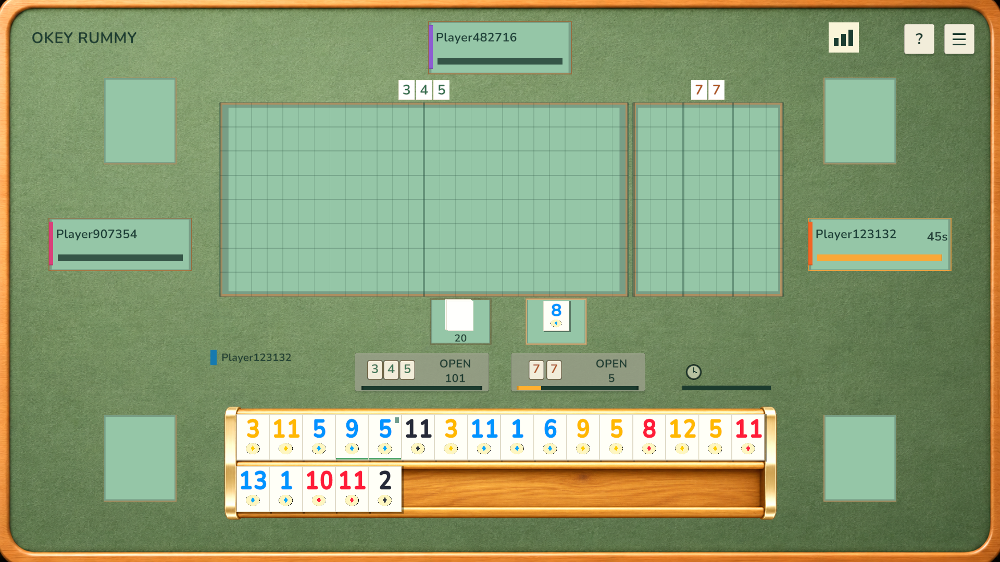
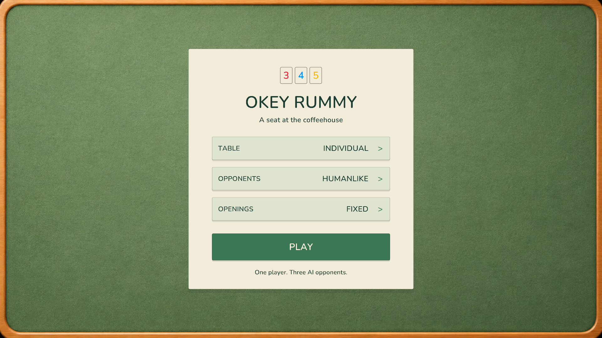
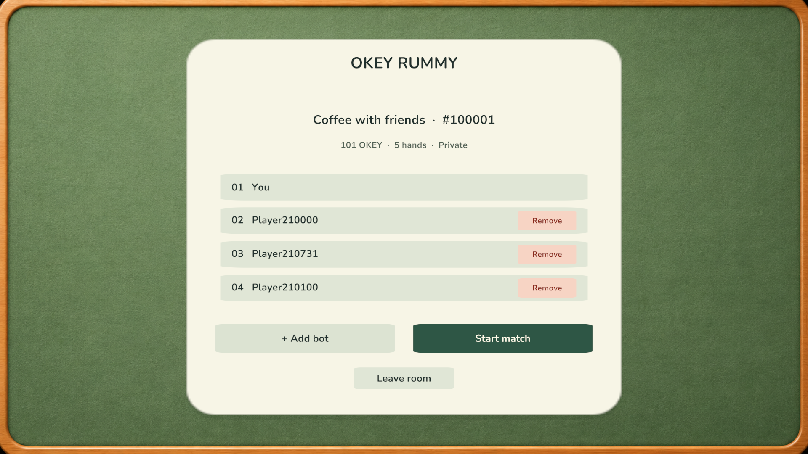
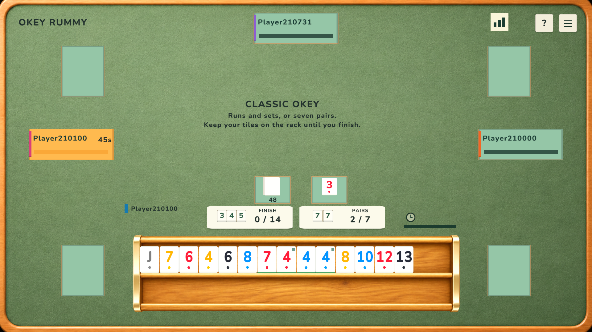
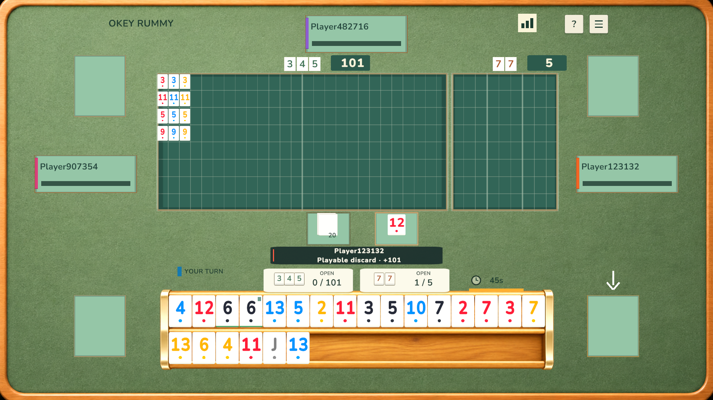
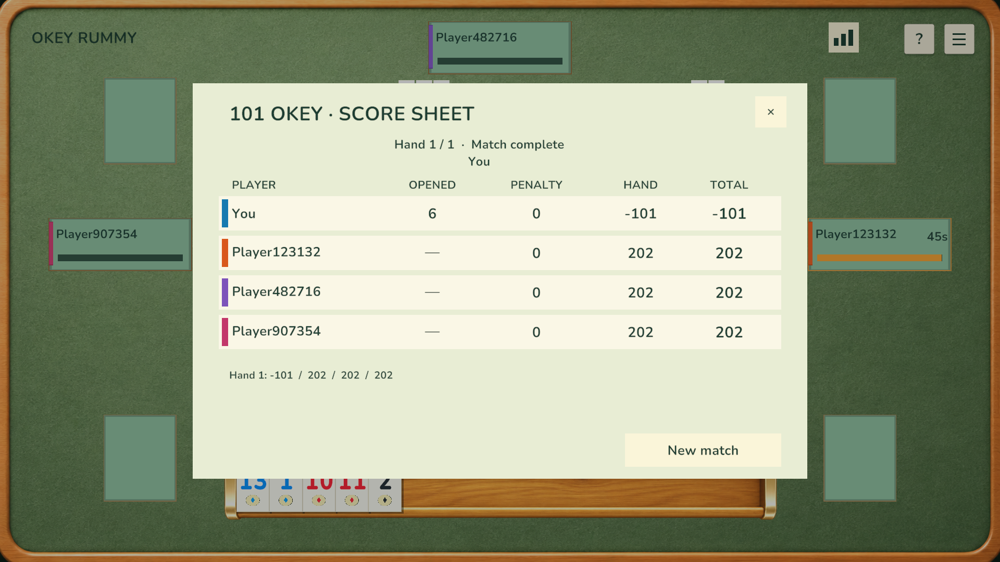
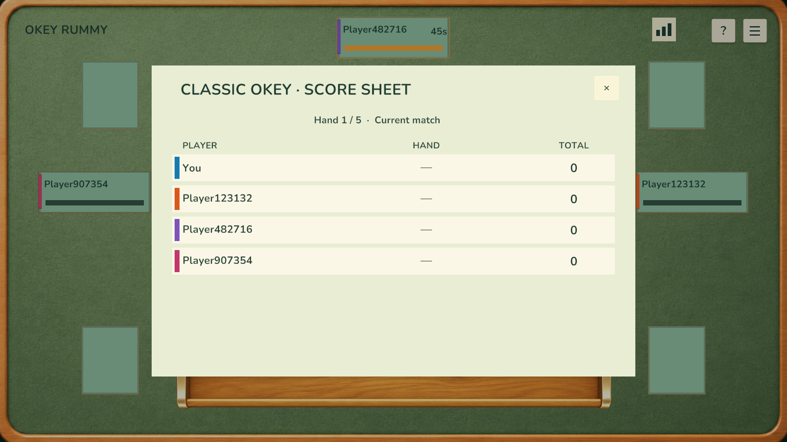
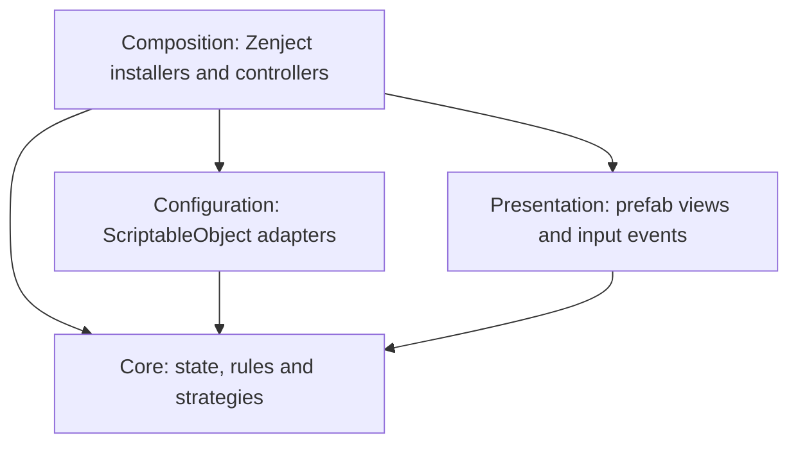

# Okey Rummy

A Unity portfolio project for tile-based Okey and Rummy games, with a warm coffeehouse table, configurable Classic Okey and 101 Okey rulesets and three local AI opponents.

Game rules and state live in a Unity-independent C# assembly. Zenject connects the application, while editable prefabs and ScriptableObjects control presentation and configuration. Classic Okey and 101 Okey share the same table, rack and input infrastructure, with separate gameplay policies, rule profiles, scoring and bot strategies.

## Run the project

1. Clone the repository and open it with **Unity 6000.3.15f1** through Unity Hub.
2. Let Unity restore the packages and import the assets.
3. Open **Assets/Scenes/MainMenu.unity** and press Play.
4. Select **Create room**, choose Classic Okey or 101 Okey, the number of hands, individual or partnership play and opponent behavior. A password is optional. 101 rooms also support rising openings and joker reclaim.
5. Add bots in the lobby, then select **Start match** when all seats are occupied. Use **Remove** beside another player to free a seat.
6. Alternatively, select **Join room** and click an available room. Open rooms join immediately; private rooms select their number and ask for a password. Joining by room number is also available.

The main menu is the first scene in Build Settings. **GameTable.unity** can also be opened directly for table development. Zenject and DOTween are included in the repository; no separate plugin installation is needed.

## Features

- Classic Okey: closed 14-tile hands, seven-pair finishes, high-one runs and discard pickup before opening.
- One human player and three AI opponents, with individual and opposite-seat partnership modes.
- Runs, sets and pairs, indicator-based real jokers and physical fake jokers.
- Series and pair opening thresholds, configurable penalties, round scoring and rising openings (*katlamalı*).
- Two rack rows with 16 editable slots each, adjacent placement, optional gaps and insertion that shifts neighboring tiles.
- Opening totals calculated from the player's actual adjacent rack groups.
- Drawing from the closed pile, corner discard trays, double-tap discarding and drag-and-drop layoffs.
- Public melds on separate series and pair boards, with reserved extension slots, compatible drop-target highlights and paging.
- Plain tile backs, manual tile flipping, distinct color settings and editable typography.
- Remaining seconds and progress bars for the active seat, with automatic legal play on timeout.
- Local room browsing, room numbers, optional passwords, configurable match length, a player lobby and adding/removing bots.
- Per-player profile ScriptableObjects, with immutable runtime identities shared by room and table presentation.
- Live remaining-hand value in 101, including the held-joker value and pair-opening multiplier.
- An optional indicator-copy pair rule, configured in the rule profile.

## Local rooms

Rooms simulate a PvP lobby locally: every non-local seat is controlled by AI. There is no online discovery or transport. The room directory and match history survive menu/table navigation for the current application session.

`LocalRooms.asset` defines the starting rooms, player profile references, available bot profiles, room-number sequence and selectable hand counts (currently 1, 3, 5, 7 and 11). The bundled private room **#102303** uses **coffee**. Creating rooms, adding/removing players and joining never modify these authored assets.

`Assets/Settings/Players/LocalPlayer.asset` defines the local identity; every seeded opponent also has a separate `PlayerProfile` asset. Stable IDs are distinct from display names. Profile fields can be extended with level or avatar data in configuration and its runtime adapter without changing room membership or join logic.

## Controls

| Action | Input |
| --- | --- |
| Draw | Click the closed pile, or drag its top tile to the rack during your turn. |
| Arrange | Drag a tile to a rack slot. Occupied slots shift toward the nearest gap. |
| Move a group | Drag the small upper-right handle on the last tile of a run, set or pair. |
| Scores | Use the bar-chart button at the top right; the sheet also opens when a hand ends. |
| Separate groups | Leave an empty slot between groups. Groups do not cross rack rows. |
| Open series or pairs in 101 | Use the opening card showing the matching tile example and opening threshold. |
| Finish Classic Okey | Discard the spare tile from a complete hand, or select **Finish** when enabled. |
| Lay off a tile | Drag it into the highlighted empty cell of a compatible public meld. |
| Discard | Drop a tile into the bottom-right tray, or double-tap it during your discard phase. |
| Flip a tile | Hold it for half a second. Hold again to turn it face up. |
| Return a trial tile in 101 | Click the previous tray again, or click the closed pile to return it and draw instead. |
| Reclaim a public joker | Once opened, drag the tile matching its assigned color and value onto the public joker. Enable **Reclaim** in the new-game menu. |
| Add a pair to the table | Once opened, drag the pair by its group handle onto the pair board. A pair opening must already exist. |
| Take the previous discard | Classic: click or drag from the previous player's highlighted tray to take the tile into your rack. 101: click or drag it to try the tile in your rack; use it in an opening, new meld, pair or legal layoff before discarding. |
| Start another game | Open table settings and select **New Game** to return to the menu. |

Rack rearrangement is available during other players' turns. Draws, openings, layoffs and discards always pass through the table's legality checks.

## Rules in this build

### Classic Okey

The starting seat receives **15 tiles**, the other seats receive **14**, and a standard deck leaves **48 tiles** in the stock after the indicator is set aside. Hands remain closed: there are no public openings, layoffs, 101 opening penalties or rising thresholds. A player may draw from the pile or take the previous seat's latest discard directly into their rack.

Discarding the spare tile wins when all fourteen remaining physical tiles can be assigned exactly once to runs and sets, or to seven identical pairs. The validator finds a complete disjoint partition, rather than judging the total value of a few high-scoring melds. The **Finish** action chooses a legal spare tile when a complete hand exists. Adjacent rack groups still drive the progress cards. A completed winning hand is exposed in the center of the table, including bot wins.

Classic runs allow **12–13–1**, but reject **13–1–2**. Real jokers substitute for missing tiles; fake jokers retain the real joker's fixed printed identity. Seven-pair completion takes priority if the same hand can also form runs. The bot protects tile coverage and considers useful previous-seat discards while keeping its hand closed.

The default score records round loss points: an ordinary winner receives zero and other players receive two. Pair and joker finishes use the profile's configurable multipliers; in this build they stack, giving four for either bonus and eight for both. Partnership tables exclude the winning partner and sum individual loss points by team. This uses the project's round-score convention; there is no cumulative twenty-point match or indicator-show bonus.

An empty stock leaves the previous discard available. Taking it continues the turn; choosing the empty pile instead ends a drawn round with zero score. Timers and the existing humanlike/fast bot modes work in both games.

The base hand, meld and pickup rules follow the [Okey rules reference](https://www.pagat.com/rummy/okey.html); score aggregation and combined bonus multipliers above are explicit project choices.

### 101 Okey

The default table uses a 106-tile deck. A random starting seat receives 22 tiles; the other seats receive 21. An indicator is set aside and 20 tiles remain in the stock. Subsequent tables rotate the starting seat. The indicator determines the real joker; fake jokers represent that fixed color and value.

An initial series opening needs **101 points**, or a pair opening needs **five pairs**. The local opening evaluator uses adjacent tiles on the same rack row and reserves a tile for the final discard. Invalid opening attempts apply a configurable penalty and preserve the hand. Additional series melds use the player's existing opening mode. After anyone opens pairs, a series-opened player may also add pairs without changing their original opening mode or score treatment. Joker assignments in public melds remain fixed. Each series or set occupies its own row. Runs use number-aligned columns: 1–2–3 starts at the left edge, while 3–4–5 reserves two positions on its left and the remaining values on its right. Sets pack their three tiles side by side; the fourth color appends to the right without moving the existing tiles. Adding tiles keeps existing tiles and other melds in place. Rows fill downward through separate lanes; page buttons or the mouse wheel keep a full board accessible without shrinking tiles.

The board headers show the live opening thresholds beside the run and pair examples. Opening cards show the adjacent rack groups as a numeric current / required total without progress bars. Turn timers retain their bars. Notifications use a non-blocking panel with queued messages and a colored accent for penalties. Once opened, the action cards change to **Add**; an empty additional-meld action is disabled and cannot charge an opening penalty.

Rising openings increase the series and pair thresholds independently. Each successful initial opening sets its corresponding next threshold to the opened total plus a configurable increment, which defaults to one. Additional melds and invalid attempts do not raise thresholds.

101 allows a trial of the previous seat's latest discard even while closed. The borrowed physical tile must participate in an opening that meets the current threshold, or, once opened, in a new meld, a pair or a legal public layoff. An unrelated opening cannot commit the pickup, and discarding is blocked until the borrowed tile is used. Clicking the tray again returns it without consuming stock; clicking the closed pile returns it and draws instead. A timeout also returns an unused trial tile before drawing. Explicit invalid opening attempts still receive the configured penalty.

With joker reclaim enabled, an opened player may replace a public real joker with the tile matching its fixed assigned color and value. The physical joker returns to the replacing player's rack, in the replacement tile's slot. The original meld owner receives the profile's **Joker Reclaim Penalty**, default **101**; zero disables the charge while keeping reclaim available. **Reclaim Off** disables the exchange itself. This project uses one exact assigned replacement for runs, sets and pairs, including sets whose missing color could otherwise be ambiguous.

The discard-use and pair-processing rules follow [Zynga's discard pickup guidance](https://zyngasupport.zendesk.com/hc/tr/articles/115003520231-Soldan-ta%C5%9F-al%C4%B1nabilir-mi) and [series-to-pairs guidance](https://zyngasupport.zendesk.com/hc/tr/articles/115003521251-Seri-a%C3%A7an-biri-%C3%A7ifte-i%C5%9Fleme-yapabilir-mi). [Zynga's joker guidance](https://zyngasupport.zendesk.com/hc/tr/articles/115003539012-Yerden-Okey-al%C4%B1nabilir-mi) requires an opened hand and a matching replacement. The optional owner charge follows the [101 Çetele rule summary](https://okey101cetele.com/blog/yandan-yerden-tas-alma); joker exchange variants differ between tables, so the exact assignment and penalty are explicit project rules.

Successful openings refresh the turn timer. When time expires, the game cancels any drag, draws once if required and discards the lowest non-joker tile that cannot extend a public meld. If none is safe, a playable tile is preferred over a joker. Discarding the final tile finishes the round. Partnership scoring groups opposite seats and excludes the winning partner's remaining hand.

Layout preview: three-tile sets stay contiguous and each meld occupies its own row.

The 101 profile enables **Allow Indicator Pairs**: the remaining physical copy of the indicator can pair with one other tile, adopting that tile's assigned pair identity. It keeps its printed value in runs, sets and remaining-hand scoring, and cannot be reclaimed as a real joker. Turning this profile setting off restores identical-pair rules. The same validator is used by adjacent rack grouping, opening checks and bot planning. The center indicator remains on the table.

These are the project's explicit rule choices. Other regional variants and indicator-show bonuses are not implemented.

## Matches, feedback and scoring

Matches default to five hands. The create-room screen selects the match length from `LocalRooms.asset`; `Match Rounds` on the table settings asset supplies the initial choice. The score-sheet button shows live penalties, each player's first opening, completed hand scores and cumulative totals. A finished hand opens the sheet automatically. **Next hand** retains the current match; after the configured number of hands, **New match** returns to the menu. Lowest totals win. History lives in memory for the current session and is reset when starting a new match from the menu.

101 and Classic use separate `IRoundScoring` implementations and authored score-sheet prefabs. `MatchHistory` keys score ledgers by rule profile and partnership setting. Partners share a color and a team total; the winner's partner contributes only their existing penalties for that hand. Classic does not display 101 opening or penalty columns.

101 defaults to **−101 for finishing**, **101 for discarding a real joker**, and **101 for discarding a tile that extends a public meld**. The rule profile exposes `Winner Score`, `Joker Discard Penalty` and `Playable Discard Penalty` independently. Zero disables either discard charge. Final-tile finishes retain the scoring policy's joker/pair bonuses rather than receiving an extra discard charge.

No player's hand count appears on the table. In 101, **LEFT** shows the local hand's remaining value: ordinary tile values plus the configured held-joker value (default 101), multiplied for a pair-opened hand. It updates after draws, openings, layoffs and discards. Existing action penalties remain separate. Classic hides this 101-specific value. Fixed openings show the required threshold alone; rising openings show the current increased requirement. Initial openings announce the player and public opening value. Local turns show **YOUR TURN** and play a short cue. Drawing, discarding, opening, laying off, penalties and finishing have quieter event sounds; all bundled clips are procedurally synthesized and can be replaced in the audio asset. Playable discards, joker discards and joker reclaims announce the affected player and charge explicitly. Notices queue so an opening or turn announcement cannot erase a penalty. Long tile moves use a configurable shallow arc.

Rack group handles use a mixed run/set/pair evaluation independent of whether an opening is legal yet. Whole-group drops remain within one shelf, shift neighboring tiles and preserve physical tile identity. Group drags never discard a group. A pair can be dropped onto the pair board when pair processing is legal; other outside-rack group drops return to the rack.

Score-sheet layout preview using a custom short test hand.

## Architecture

| Assembly | Responsibility |
| --- | --- |
| `Okey.Core` | Immutable tile definitions, physical identities, decks, rack arrangement, meld validation, table state, scoring, AI observations, room membership and player identities. It has no Unity engine references. |
| `Okey.Configuration` | Converts editable assets into rule, deck, table, room, player identity and navigation settings. |
| `Okey.Presentation` | Passive table views, tile faces, pointer input, rack anchors, progress bars, menus and animations. |
| `Okey.Composition` | Creates dependencies, coordinates views with the table and routes local, bot and timeout actions. |

`TableSession` owns hands, turn phase, public melds and discard histories. `ITableGame` supplies public-meld permissions, discard behavior, finish validation, rack action plans and scoring through `Okey101Game` or `ClassicOkeyGame`. Its `IOpeningPolicy` owns opening acceptance, penalties, rising thresholds and layoff eligibility. The table has no game-name or mode-enum branches. Presentation does not decide move legality. Immutable `TableActionNotice` events drive public announcements and sound cues. `TimeoutDiscardPolicy` owns timeout choices; `MatchScoreLedger` records immutable round snapshots without Unity dependencies. The table retains ownership mutation internally; published hands expose `IReadOnlyRack` and a separate `IRackLayout` for local reordering. `RackArrangement` manages single-tile and atomic group placement independently of turn rules, and `RackMeldEvaluator` evaluates the local arrangement without Unity APIs.

Room data follows the same separation. `Core/Rooms` owns membership, capacity, password checks and immutable room options; `Core/Players/PlayerIdentity` carries stable player identity. `Configuration/RoomCatalog` and `PlayerProfile` adapt ScriptableObjects into runtime data. `RoomMenuController` coordinates joins, removals, setup snapshots and navigation. `RoomMenuView`, `RoomListItemView` and `RoomSeatView` only render supplied values and emit input events. Room list rows reuse a prefab and are pooled when browsing again. Layout, fonts, colors and button styling stay in prefabs.

`StoneInstance` gives each physical tile an ID; duplicate printed tiles remain separate objects. Deck generation, shuffling, distribution and view creation are separate responsibilities. `IStoneShuffler` supports replaceable ordering, and seeded implementations support deterministic tests.

### Extension points

| Change | Boundary |
| --- | --- |
| Deck composition, tile range or copy count | `DeckSettings` / `DeckDefinition` |
| A new game mode | Derive a `TableRuleProfile`, supply an `ITableGame` with an opening policy and rack action plans, then add the asset to `TableSettings` and assign its score-sheet prefab in `GameInstaller` |
| Run, set, pair or joker validation | `IMeldRules` / `OkeyRules.AllowsHighOne` / `OkeyRules.AllowsIndicatorPairs` |
| End-of-round scoring | `IRoundScoring` |
| Opponent decisions | `IBotDecisionPolicy`; `IPlayerStrategy` provides meld planning and discard ranking |
| Behavioral randomness | `IRandomSource` |
| Room presets and player profile fields | `RoomCatalog` / `PlayerProfile` → `PlayerIdentity` |
| Local player and seat-relative presentation | `LocalPlayerContext`, assigned by the game installer |
| Menu and table navigation | `ITableNavigation` |
| Tile art, text, colors and animation | Prefabs and visual settings assets |

Opponent hand counts are hidden. Humanlike opponents use the joined room's player profiles; direct table development falls back to names in the text catalog. Fast mode uses seat names. Name changes update opponent cards, turn status and winner text together.

Fast opponents play at a fixed pace. Humanlike opponents use configurable thinking delays, opening patience and a default 1% mistake chance per discard decision. Their strategies receive snapshots of their own hand and public information; they cannot inspect opponents' hands or the stock. `BotDecisionPolicy` chooses draw/pickup/open/layoff/discard actions from a `PlayerTurnObservation`. `BotTurnController` only schedules and submits those decisions. A rule profile can replace the whole decision policy through `CreateBotDecisions`. The 101 discard strategy protects complete melds, real jokers and tiles that extend public melds. It ranks remaining tiles by weighted adjacent/gap/set/duplicate connections, preferring lower isolated values. Connection weights live in `StandardBotStrategy.asset`. Public layoffs prioritize higher ordinary values; a real joker is retained for new melds until only a layoff and final discard remain. The configured humanlike mistake chance can still produce a poor move. Bot decisions use current rising thresholds; `TableSession.TryApply` validates submitted `PlayerAction` values.

Multiplayer is not implemented. A future transport adapter can submit `PlayerAction` values to the table boundary and distribute public and seat-private state. It must add session identity, authoritative validation, synchronization and visibility handling. Variants that keep the draw/open/layoff/discard turn flow can replace opening policies, finish logic, scoring, bot decisions and rack action plans. A different turn lifecycle requires extending the turn flow; numeric configuration alone does not implement every variant.

## Configuration and presentation

| Asset | Editable values |
| --- | --- |
| `Assets/Settings/Tables/Standard101Table.asset` | Available rule profiles, selected profile, player count, rising increment, partnerships, pickup and joker reclaim rules, starter selection, timers, match hand count and bot behavior. |
| `Assets/Settings/Rooms/LocalRooms.asset` | Seeded rooms, passwords, profile lists, bot candidates, room numbering and available hand counts. |
| `Assets/Settings/Players/*.asset` | A stable ID and editable display name for each local/fake player. |
| `Assets/Settings/Tables/StandardBotStrategy.asset` | 101 bot discard connection weights and low-tile preference. |
| `Assets/Settings/Tables/Okey101Rules.asset` | 101 hand size, tile range, opening thresholds, indicator pairs, bot strategy, penalties (including joker reclaim) and score multipliers. |
| `Assets/Settings/Tables/ClassicOkeyRules.asset` | Classic hand size, tile range, pair count, round loss points and score multipliers. |
| `Assets/Settings/Decks/StandardOkeyDeck.asset` | Tile types, colors, number ranges and copies. |
| `Assets/Settings/Tables/StandardShuffle.asset` | Fixed or random shuffle seed. Hand sizes belong to the rule profiles. |
| `Assets/Settings/Navigation/SceneNavigation.asset` | Menu and table scene names. |
| `Assets/Settings/Stones/DefaultStoneVisualSettings.asset` | Printed tile colors and fake-joker text. |
| `Assets/Settings/Animations/DefaultStoneMotionSettings.asset` | Movement duration, easing, arc height, arc distance and time scaling. |
| `Assets/Prefabs/NewGameMenu.prefab` | Home/create/join/lobby layouts, inputs, seat removal, fonts, colors and transition. |
| `Assets/Prefabs/RoomListItem.prefab` | Clickable room row layout, label, enter affordance and button styling. |
| `Assets/Prefabs/GameControls.prefab` | Draw surface, discard trays, opening cards, boards, opponent cards, timers, help and settings. |
| `Assets/Prefabs/Istaka.prefab` | Rack geometry, row capacity, slot anchors and tile scale. |
| `Assets/Prefabs/Stone.prefab` | Tile body, font, symbol, face visibility, selection, group handle and hold behavior. |
| `Assets/Prefabs/Okey101Scoreboard.prefab` | 101 score-sheet layout, opening values, penalties, hand scores, totals and wording. |
| `Assets/Prefabs/ClassicOkeyScoreboard.prefab` | Separate Classic score sheet with hand loss points and totals. |
| `Assets/Settings/Presentation/SeatColors.asset` | Individual and partner team colors. |
| `Assets/Settings/Presentation/TableAudio.asset` | Event clips, individual gains and master gain; zero gain mutes sounds. |

### Editing UI without changing code

Open **Assets/Prefabs/GameControls.prefab** in Prefab Mode. Its root **TableView** contains references to the small views that own each part of the screen. Select the child text object to edit its TextMeshPro and RectTransform settings. Hidden panels remain editable in Prefab Mode.

| Change | Edit here |
| --- | --- |
| Font asset, font size, alignment, wrapping, spacing or text color | The selected text object's TextMeshPro component inside the prefab |
| Position, anchors, pivot, width or height | That object's RectTransform; moving the parent moves the whole card/panel |
| Game name | **GameControls > Canvas > Brand > GameTitle** and **NewGameMenu > Home > Brand**, directly in their TextMeshPro text fields |
| Numeric formats | The relevant TextMeshPro text field: for example `LEFT {0}`, `{0} / {1}`, `{0:0}s` or `{0} HANDS` |
| Status messages, changing button labels and notices | Serialized wording on **TableHudView**, **MeldActionView**, **TableOptionsView**, **TableFeedbackView** and **NewGameMenuView** |
| Player names | **Assets/Settings/Players/** profiles; fast-mode seat labels live on **TablePlayersView** |
| Fixed headings and instructions | Their own text objects inside the prefab; **ClassicTitle** and **ClassicDescription** have independent font sizes |
| Opening-card behavior, examples and current/required text | **MeldActionView** on each series/pair card |
| Clock bars and clock text references | **TurnClockView** on the turn clock |
| Modal buttons and help text reference | **OverlayPanelsView** on the canvas |
| Table settings buttons and labels | **TableOptionsView** on the canvas |
| Tray and opponent highlights | **DiscardTray > AvailableHighlight**, **DrawPileTray > ReadyHighlight / HoverHighlight**, and **SeatBadge > ActiveHighlight**: edit their SpriteRenderer components |
| Notification accents | **Accent** and its **FailureAccent** child: edit their Image components |
| Draw, discard, board and winning-hand geometry | **TableSurfaceView** on the root; board cells use each **MeldBoardView** |

Save changes in Prefab Mode outside Play Mode. Scene-instance overrides take precedence over prefab values; changes made to runtime instances during Play Mode disappear when Play Mode ends. Numeric text uses the template authored on its TextMeshPro component when the view starts. State-dependent wording lives on the responsible view in the same prefab. Static headings are never rewritten by the presenters. There is no separate text catalog or localization asset. Availability, hover, active-seat and penalty views toggle authored visual objects; their colors stay on SpriteRenderer/Image components. Tile colors and shared player/team identity colors remain data-driven palettes.

### Presentation boundaries and folders

The project uses a model, controller and presenter/view separation with Zenject. It is not described as strict MVC: presenters translate model state into text and view values, while controllers route user/bot/timeout actions. Views hold serialized scene references and render supplied values; they do not inspect a TableSession or decide Okey rules.

- **Core/**: Unity-independent game model, rules, scoring and AI strategies.
- **Composition/Controllers/**: input actions, bot turns, timeouts, options and navigation requests.
- **Composition/Presenters/**: hand/public-tile synchronization, HUD state, score-sheet formatting and event feedback.
- **Composition/Installers/**: Zenject bindings and startup order.
- **Composition/State/**: application flow state, local-seat mapping and table display names.
- **Composition/Factories/** and **Navigation/**: prefab creation and scene transitions.
- **Presentation/Tables/**, **Racks/**, **Stones/** and **Menus/**: feature views.
- **Configuration/**: ScriptableObject definitions for rules, rooms, players and authored settings.
- **Settings/**: asset instances grouped by feature; **Resources/ProjectContext.prefab** owns shared application bindings.

**TableView** is a reference container. **TableHudPresenter** formats the action plans supplied by the game and combines them with local input availability. The prefab holds an ordered array of action cards; add enough cards for the selected game. **TurnController** submits player actions. **TablePresenter** synchronizes public physical tiles. Layout values live in prefabs, wording lives in prefab text components and view fields, and game values live in rule profiles. Constants that describe structural rules, such as two tiles per pair, still belong in code.

The table canvas uses its assigned scene camera so dragged tiles can render above ordinary controls. Its sorting order and each tile’s drag sorting order are authored in their prefabs. Both rack and pile drags restore the original order on drop or cancellation.

**ProjectInstaller**, on **Assets/Resources/ProjectContext.prefab**, binds shared table defaults, shuffle settings, navigation settings, room profiles and a plain C# **GameFlowState**. Zenject owns its application lifetime; scene installers receive it through injection. Scene installers hold scene-specific camera and prefab references. Runtime controllers do not construct UI layouts or assign font sizes and RectTransform dimensions. DOTween handles movement and short transitions; views cancel their owned tweens when disabled. `TableSettings` contains authored defaults. `GameFlowState` owns the application’s menu choices in a `GameSetup` and its `StartingSeatSequence` across menu/table navigation. Each table receives its own rules/options snapshot and `BotPreferences`; live changes never mutate the authored asset. Bot-mode changes apply to the current table and become the next menu default. Partnership and rising-opening choices apply to the next table.

## Verification

Open **Window > General > Test Runner** and run both **EditMode** and **PlayMode** suites.

EditMode tests cover definitions, deck generation, rack insertion, adjacent grouping, meld rules, penalties, rising thresholds, AI decisions, timers, ownership boundaries, replaceable opening policies and independent setup snapshots. PlayMode tests load actual scenes and verify Zenject bindings, prefab wiring, pointer interactions, drawing, Classic discard pickup through real mouse input, trial returns, joker exchanges, pair group drops, queued feedback, discarding, layoffs, visibility, menu navigation, UI progress, clickable room joining, private-room passwords, seat removal, match lengths and local players in every supported seat.

Table and menu layouts are also checked at **1920 × 1080** and **1106 × 614**. Preview images live in `Docs/Images`.

## Dependencies and art

- **Unity 6000.3.15f1**, Universal Render Pipeline 2D, Input System and TextMesh Pro.
- **Zenject 9.2.0** and **DOTween 1.3.030**, vendored under `Assets/Plugins` with their license files.
- **Nunito Bold**, distributed under the SIL Open Font License in `Assets/Art/Fonts/OFL.txt`.
- AI-generated coffeehouse backdrop and oak rack. Their creation notes are in [Assets/Art/Table/README.md](Assets/Art/Table/README.md).

Game code uses focused responsibilities, dependency injection at replaceable boundaries and editable configuration. Development commits use plain English descriptions.
